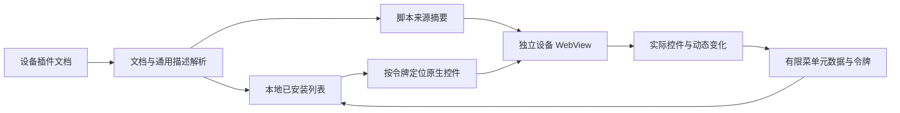

# 通用插件接入与配置页面

当前实现不维护插件名称白名单、按钮文案映射、专属 DOM 选择器、固定服务端口、面板登录存储或 Shell 操作模板。此前按猫猫／OpenSSH 分类的逻辑已移除；历史方案见各版本更新说明。

## 旧插件：渲染实际配置界面

上游 `main.js` 的 customHead 流程从 `/api/get_custom_head` 读取 HTML，经 `DOMParser` 解析后把 style/link/meta 和重新创建的 script 插入设备网页。插件继续使用该页提供的 `runShellWithRoot`、`common_headers`、`createFixedToast`、`collapseGen` 等宿主能力。兼容层在这个网页中追踪实际生成的 DOM，不在本地主界面执行源码，也不重写插件业务逻辑。

未声明独立设置页的已安装插件统一显示「配置页面」。客户端读取当前修订下所有启用插件的脚本指纹／URL，传入选中的插件 ID，在独立设备 WebView 中展示该插件生成的完整 DOM 分支。按钮、输入框、textarea、select、iframe、自定义内容和后续异步变更沿用原始节点。其他插件及设备宿主的兄弟分支由样式隐藏；共享的祖先容器保留，以免破坏现有选择器与事件。界面首次展示时展开相关 UFI 折叠区，不模拟安装、启停或上传按钮的点击。

配置窗口提供刷新和「显示完整设备页面／返回插件配置」。切换只改变可见分支，不克隆、搬移或重建表单，因此保留输入、事件及 iframe 会话。刷新则重新载入设备网页。宿主认证仍由设备网页管理；需要登录时显示完整设备页面即可。插件没有生成可识别 DOM 时显示等待与登录入口，归属到选中插件的脚本错误会显示失败信息；原生页面始终可从插件管理打开。插件之间切换即使 URL 和修订相同，也按选中的 ID 重建配置窗口，避免复用错误界面。

脚本来源归属是兼容性机制，不是插件之间的安全边界；设备网页仍加载其中全部启用插件。无法追踪的原地文本修改、自定义加载器等情况应使用完整设备页面。通用配置视图允许加载当前设备相同协议和主机下其他端口的 iframe／面板，以及这些来源的 Blob 下载；其他主机和本地文件仍不允许导航。

## 自动发现实际菜单

从当前设备 `/api/get_custom_head` 读取已安装内容，沿用设备自己的成对标记和禁用包装。插件市场与已安装列表独立，任意名称的插件都使用同一条路径。



插件源码只在设备网页上下文运行，继续使用设备原有的全局函数、弹窗、认证、文件选择器。客户端不重写各插件的安装、删除或上传流程，也不从源码中提取登录信息。

运行时按脚本内容指纹和外部脚本 URL 标记控件归属，追踪定时器、Promise、事件回调和后续 DOM 变更。WebKit 的普通内联脚本堆栈可能忽略 `sourceURL`，因此还给执行脚本分配互不重叠的行号区间，以识别原生 async/await 恢复后的调用；只增加换行，不使用 eval 或函数包装，保留全局声明语义。额外换行总量限制为 8 MiB，超过后仍保留其他归属与完整页面入口。

支持按钮、链接、button/submit 输入、summary、select 和 role=button。归属不明但出现在 UFI 扩展菜单区域的新控件显示为「其他插件菜单」。UFI 宿主的菜单容器、折叠和遥测刷新约定集中在设备页面脚本中，不含任何插件专属 DOM。

选择菜单只打开该插件的配置视图、展开宿主折叠区域并高亮原控件。用户随后在原生窗口执行操作，因此文件选择和插件确认仍有真实用户手势。菜单更新保留现有插件行和按钮，避免打断正在进行的点击。

没有标准控件的插件仍可在配置视图中显示其可归属的 DOM；无法追踪的内容可通过「原生页面」访问。自动发现不保证任意网页都能正确归属。

## 可选清单：独立设置页

旧插件不需要添加清单。插件作者如果希望直接打开独立页面，可在自己的插件内容内添加一个不可执行的 JSON script：

```html
<script type="application/json" data-ufi-plugin-manifest>
{
  "version": 1,
  "settings": {
    "url": "./settings/#/overview",
    "port": 9123
  }
}
</script>
```

- `version` 必须为整数 `1`。
- `settings` 可省略；存在时 `url` 必填，使用标准 URL 相对当前设备页面解析。
- `./settings/` 保留设备的反向代理前缀；`/settings/` 从域名根目录开始。查询参数和 hash 路由按声明保留。
- `port` 可省略；存在时为 1–65535 的整数，替换当前设备的端口。没有默认插件端口。
- 地址必须使用当前设备相同的协议和主机，支持同设备其他端口；不允许 URL 用户名／密码、其他主机或非 HTTP/HTTPS 协议。
- 一个插件最多一份清单，JSON 文本最多 16 KiB。重复、未知版本、无效 JSON 或不合规地址会提示并回退通用配置页面，不阻断其他插件，也不修改源码。

有效声明会显示统一的「设置面板」按钮；「管理 → 原生页面」始终保留。客户端只打开声明的 URL，不向面板注入控制器配置、登录信息或特定 localStorage。插件自己的面板负责配置和认证。可执行源码里的 URL 字符串不会被当成清单。

## 模块职责与接口

| 模块 | 职责 |
| --- | --- |
| `src/core/plugin-description.cjs` | 单一 `describePlugin(source, deviceAddress)` 接口；解析通用声明及脚本来源，不执行代码，不接收插件名 |
| `src/core/plugins.cjs` | 文档保留、修订冲突、逐插件修改和设置目标选择；只消费通用描述 |
| `src-tauri/src/plugin-menu-runtime.js` | 在设备页面追踪来源和实际控件；忽略原生弹窗和数据 script，发送有限菜单元数据 |
| `src-tauri/src/plugin-view-runtime.js` / `plugin-view.css` | 展示选中插件的 DOM 分支，保留表单、事件、iframe 与宿主弹窗，支持切换完整页面 |
| `src-tauri/src/plugin_menus.rs` | 有界接收元数据，校验当前设备／修订／实例／令牌 |
| `src-tauri/src/device_pages.rs` | 独立设备窗口、导航与下载、设备切换和修订失效 |
| `src-tauri/src/device-page-lifecycle.js` | UFI 宿主页面失焦时暂停自身遥测，恢复时尊重用户暂停状态 |
| `src/renderer/plugins-ui.mjs` | 根据通用能力呈现列表、菜单和管理操作，无插件类别分支 |

设备页面不能调用本地主界面的桌面桥接。元数据最多 128 项，字段受长度和类型约束；接口不接受来自设备的本机命令或任意选择器。打开菜单前重新读取修订，设备切换、断开、插件禁用／变更会使旧窗口和令牌失效。

逻辑页面对应独立的原生窗口实例标识，避免 WebKit 异步销毁期间同标签重建失败。下载处理按设备会话的数据目录注册一次，避免旧窗口遗留的 WebContext 回调取消新窗口的备份下载；输出仍限定系统下载目录，并使用随机文件名前缀且禁止覆盖。

未标记、重复名称、破损或嵌套标记的原始内容保持不变；逐插件修改只替换被选中的片段。源码保存继续使用现有确认与修订检查。设备接口没有原子条件写入，多管理端同时提交仍可能出现竞争。

## 验证方式

`npm test` 验证改名不改变能力、声明地址、无效清单回退、数据脚本和注释处理、禁用及修订冲突。`npm run test:plugin-view` 在原生 WebKit 中验证未知插件的完整表单、异步控件、折叠区、iframe、切换完整页面时的状态保留、原始异步事件、弹窗、文件选择上传、外部脚本、切换插件和设备失效。该脚本也可通过 `UFI_PLUGIN_SAMPLE_FILES`（文件路径 JSON 数组）载入所提供的猫猫及 SSH 原始脚本，在模拟设备宿主中验证其界面，不执行真实 Shell。报告见 `artifacts/plugin-view-validation.json`。

`npm run test:plugin-menus` 用多个未知插件验证内联／外部脚本、异步菜单、不同容器、改名和更换文案、原生弹窗、文件选择上传、数据 JSON 不被改写、动态增删以及失效流程。`npm run test:plugins` 验证声明面板、原生回退、安装管理、上传下载、遥测暂停和桌面隔离。
